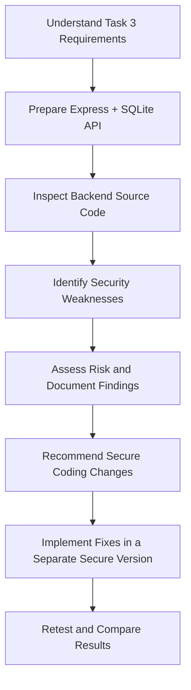

<div align="center">

# 🔐 CodeAlpha — Secure Coding Review

### Task 3 | Cybersecurity Internship

**A deliberately vulnerable Node.js, Express, and SQLite API built as a controlled environment for learning secure code review.**


> ⚠️ **EDUCATIONAL LAB ONLY — INTENTIONALLY INSECURE**
>
> Run locally with fictional data only. Do not deploy this application, expose it to a network, or reuse its vulnerable patterns in a real system.

</div>

---

## 📌 Project Overview

This repository was created for **CodeAlpha Cybersecurity Internship — Task 3: Secure Coding Review**.

The task is to select an application, inspect its source code, identify security weaknesses, assess their potential impact, and document recommendations for remediation.

To carry out the review, I prepared a small backend authentication and user-management API using **Node.js, Express, and SQLite**. The application intentionally contains insecure coding patterns so that they can be examined in a controlled local environment.

The project is an **audit target**, not a production-ready authentication system.

## 🎯 What Was the Task?

The objective of Secure Coding Review is to understand how vulnerabilities can enter an application's source code and how developers can recognize and prevent them.

The work focuses on:

- Reviewing backend source code and request handling.
- Tracing user input into database operations.
- Examining password handling and login logic.
- Checking authentication and authorization controls.
- Reviewing input validation and error handling.
- Recording findings with evidence, severity, impact, and recommended fixes.

## 🧰 Technology Stack

| Technology | Purpose |
|---|---|
| Node.js | JavaScript runtime |
| Express.js | REST API and HTTP routes |
| SQLite | Local database |
| JavaScript | Backend implementation |
| Manual code review | Source-level security inspection |

## 🏗️ Application Features

The lab provides a small set of API routes to support the review:

| Method | Endpoint | Purpose |
|---|---|---|
| `GET` | `/` | Application information |
| `GET` | `/health` | Health check |
| `POST` | `/register` | Register a user |
| `POST` | `/login` | Check login credentials |
| `GET` | `/users?username=demo` | Look up a user |
| `GET` | `/profile/:id` | Retrieve a user profile |

The SQLite database is created locally when the application starts. A fictional demo account is seeded for testing.

## 🔍 Security Areas Reviewed

The source review identified the following areas that require remediation:

| Finding | Security concern | Severity assessment |
|---|---|---|
| SQL injection in login query | Request values are interpolated into SQL | High |
| SQL injection in user lookup | Username query parameter is concatenated into SQL | High |
| Plaintext password storage | Passwords are stored and compared without password hashing | High |
| Missing profile authorization | Profile records can be requested without an authenticated ownership check | Medium |
| No login rate limiting | Repeated login attempts are not throttled | Medium |
| Missing registration validation | Input types, formats, and lengths are not sufficiently validated | Medium |
| Detailed error disclosure | Database error messages are returned to clients | Low–Medium |

**Severity ratings are preliminary assessments based on source-code review.** Actual exploitability and impact should be validated in the local test environment.

## 🧭 Audit Workflow



## 📂 Repository Structure

```text
CodeAlpha_SecureCodingReview/
│
├── src/
│   └── server.js
│
├── docs/
│   └── AUDIT_CHECKLIST.md
│
├── data/
│   └── lab.sqlite       # Generated locally; not committed
│
├── package.json
├── package-lock.json   # Generated after npm install
├── .gitignore
└── README.md
```

## ⚙️ Installation & Setup

### Prerequisites

- [Node.js](https://nodejs.org/) version 18 or newer
- npm
- Visual Studio Code (recommended)

### 1. Clone the repository

```bash
git clone https://github.com/YOUR-USERNAME/CodeAlpha_SecureCodingReview.git
cd CodeAlpha_SecureCodingReview
```

### 2. Install dependencies

```bash
npm install
```

### 3. Start the application

```bash
npm start
```

The API runs locally at:

```text
http://127.0.0.1:3000
```

Check the health endpoint:

```text
http://127.0.0.1:3000/health
```

Expected response:

```json
{
  "status": "ok"
}
```

The SQLite database is generated automatically in the local `data/` directory.

## 🧪 Example API Requests

### Health check

```bash
curl http://127.0.0.1:3000/health
```

### Register a fictional user

```bash
curl -X POST http://127.0.0.1:3000/register \
  -H "Content-Type: application/json" \
  -d '{"username":"alice","password":"example123"}'
```

### Login with the demo account

```bash
curl -X POST http://127.0.0.1:3000/login \
  -H "Content-Type: application/json" \
  -d '{"username":"demo","password":"demo123"}'
```

### Look up a user

```bash
curl "http://127.0.0.1:3000/users?username=demo"
```

### Retrieve a profile

```bash
curl http://127.0.0.1:3000/profile/1
```

These examples are for the local training API only. Use fictional accounts and do not test against third-party systems.

## 📝 What I Have Completed

- [x] Reviewed the CodeAlpha Task 3 requirements.
- [x] Prepared a Node.js and Express backend for security auditing.
- [x] Integrated SQLite for local data storage.
- [x] Identified security weaknesses through source-code inspection.
- [x] Prepared a vulnerability checklist.
- [x] Documented findings, potential impact, and recommended remediation in a preliminary audit report.

## 🚧 Current Status & Next Steps

This repository currently contains the **intentionally vulnerable audit target**. The secure implementation and final retesting are separate follow-up stages.

- [ ] Implement parameterized SQL queries throughout.
- [ ] Hash passwords using a suitable password-hashing algorithm.
- [ ] Add authentication and object-level authorization.
- [ ] Add login rate limiting.
- [ ] Validate request data and enforce input constraints.
- [ ] Replace detailed client-facing errors with safe messages.
- [ ] Retest each finding and record actual results.
- [ ] Add screenshots and final before-and-after evidence.

Only mark a remediation as complete after implementing and testing it.

## 📄 Audit Documentation

The accompanying **Security Audit Report (PDF)** documents the preliminary findings, their source locations, potential impact, severity assessments, and recommended remediation.

Add the PDF to this repository (for example, under `docs/`) before publishing the repository if you want it available alongside the source code.

## 🛡️ Responsible Use & Safety

- This application is intentionally vulnerable and is designed only for educational code-review practice.
- The server binds to `127.0.0.1` to limit access to the local machine.
- Do not deploy it to a public hosting provider or expose it to a shared network.
- Do not use real credentials, personal information, or production data.
- Do not treat the current code as a secure authentication implementation.

## 👨‍💻 Author

**[Your Name]**  
Cybersecurity Intern — CodeAlpha  
Task 3: Secure Coding Review

---

<div align="center">

**Learning to identify insecure code is a first step toward building secure software.**

</div>
